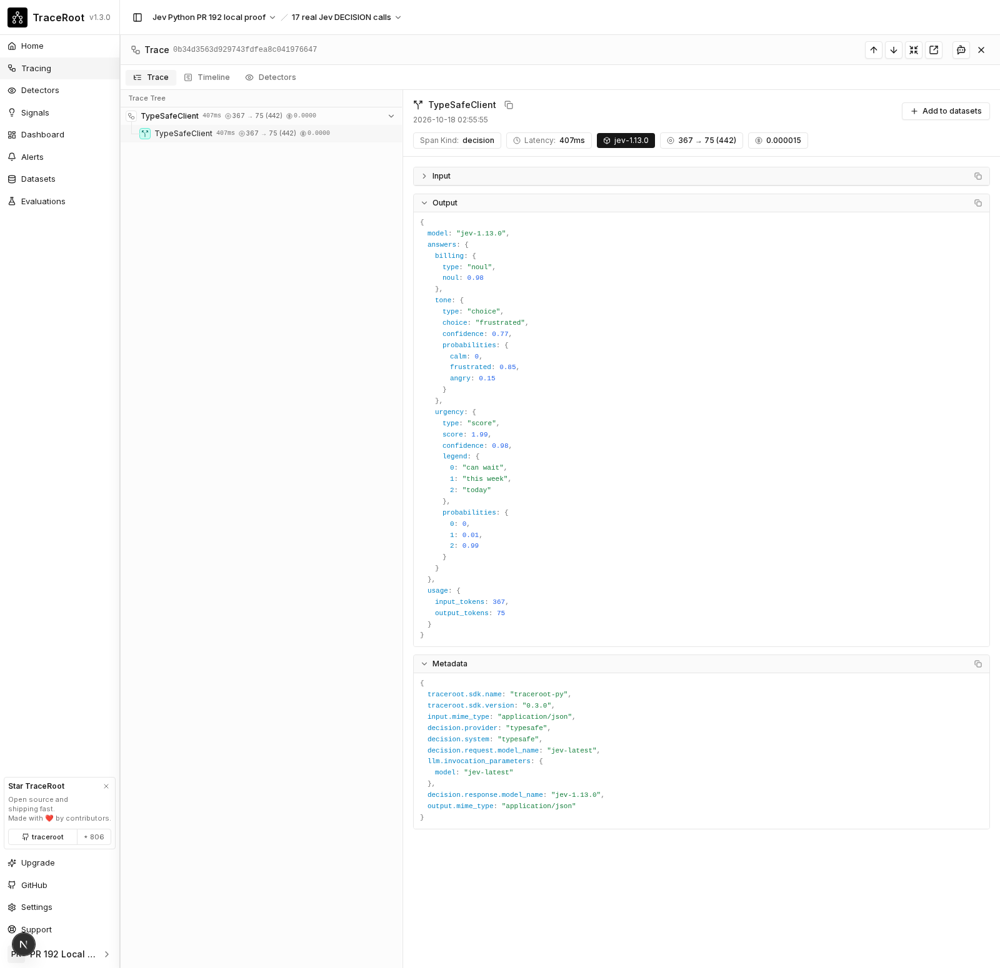
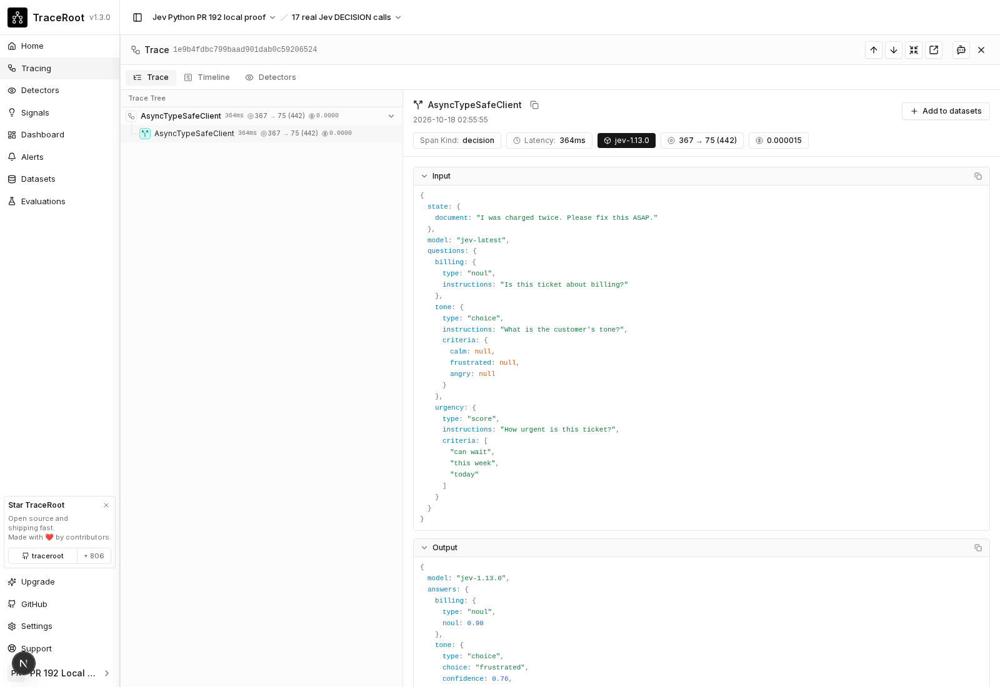
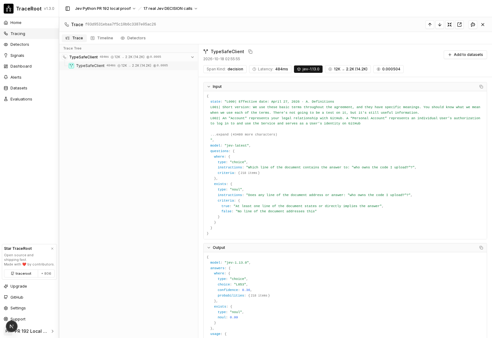

# Local verification: PR #192

Successful live suite: **2026-10-17 21:26 UTC** (2026-10-18 in India).

- SDK/scenario commit: `5f2c3dbf02382ea1ff6efda465918fc9a07e2625`.
- Platform main: `5f0b1e9539c8ab66b325f68832ebd04eb9f2387c`, including merged DECISION ingestion/UI support from traceroot#2538.
- Fresh installed wheel: TraceRoot 0.3.0, typesafe-sdk 0.7.5, openinference-instrumentation-typesafe 0.1.5, Python 3.11.16. The installed wheel's Python package bytes match this source commit. The runner was invoked from `/tmp`, outside the SDK checkout.
- Requested `jev-latest`; every response and stored span resolved to `jev-1.13.0`.

| Scenario | Real calls | Stored DECISION spans |
| --- | ---: | ---: |
| Synchronous quickstart | 1 | 1 |
| Asynchronous quickstart | 1 | 1 |
| Semantic search | 4 | 4 |
| Structure recovery | 2 | 2 |
| Email, phone and invoice extraction | 9 | 9 |
| Total | 17 | 17 |

Every call passed the checks listed in [report.json](report.json): one span, OK status, complete input/questions and answers, real HTTP response equality, resolved model, input/output/derived-total tokens, exact input-only cost, requested alias metadata, and user/session propagation. The large search input is compared in full, rather than just its preview. Example stdout also matches a logic-only replay of captured API responses; this is not a second independent live run.

The report contains all 17 trace/span IDs, answers, token counts, costs, input/output sizes and SHA-256 values. Its localhost trace URLs only work on this test machine. The screenshots below are the actual authenticated local UI, with the individual DECISION span selected.

## Screenshots

### Synchronous quickstart input


### Synchronous quickstart output and metadata



### Asynchronous quickstart



### Semantic search with a large document



## Additional validation

| Check | Result |
| --- | --- |
| Full locked Python suite | 838 passed in 389.09s |
| Fresh wheel, instrumentor 0.1.4 minimum, SDK 0.7.5 | 53 passed; dependency check passed |
| Fresh wheel, instrumentor 0.1.5 latest allowed, SDK 0.7.5 | 53 passed; dependency check passed |
| Existing platform ingestion contract tests | 177 passed in 133.15s |
| Ruff lint / format | Passed; 109 files already formatted |
| Git whitespace check | Passed |
| Browser page errors during three trace captures | None |

The locked suite and fresh-install tests ran on `3b0b176`; the following `5f2c3db` changes only the example formatter constant and its documentation. Lint, format, the full live suite and screenshots include that fix. An initial live attempt stopped on the formatter typo; the 17 calls reported here belong to the subsequent complete successful run.

## Local setup and reproduction

Follow the [suite README](../README.md) to build/install the wheel and run against your own local project. This run used the repository's `make dev` launcher (`tmux_tools.launcher.make_driver().run(detached=True)`) with an isolated tmux/Compose project and separate infrastructure ports. The normal REST, frontend, Celery worker, migrations, and unmodified model price catalog were used. A local workspace, project, hashed project API key, and UI test account were seeded; the real TypeSafe key remained in a private env file.

MinIO's public binary/image download was unavailable in this environment, so the local server was built from official MinIO tag `RELEASE.2025-09-07T16-13-09Z` (commit `07c3a429bfed433e49018cb0f78a52145d4bedeb`), with `mc` tag `RELEASE.2025-08-13T08-35-41Z`. These local infrastructure changes are not SDK changes. No public-cloud deployment or CI success is implied by this local proof.

```bash
cd /tmp
/path/to/fresh-env/bin/python /path/to/traceroot-py/scripts/verify_typesafe_e2e.py \
  --env-file /private/jev-local.env \
  --host-url http://localhost:8000 \
  --git-ref 5f2c3dbf02382ea1ff6efda465918fc9a07e2625 \
  --platform-ref 5f0b1e9539c8ab66b325f68832ebd04eb9f2387c \
  --output /tmp/jev-evidence
```

The environment file must contain the real `TYPESAFE_API_KEY` and a `TRACEROOT_API_KEY` belonging to that local instance. Credentials and browser session state are excluded from this evidence.
